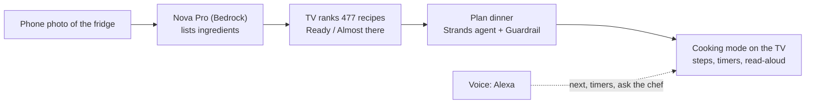

# CookAlong for Fire TV

CookAlong is a hands-free recipe companion for Amazon Fire TV. You browse recipes on shelves and scale servings. Cooking mode shows one big step at a time, runs several kitchen timers with a chime, and hands the shopping list to your phone with a QR code. Cooking works fully offline, with no account; online recipes, Fridge scan and Alexa are optional extras.

Built natively with **Kotlin + Jetpack Compose for TV** (`androidx.tv:tv-material`). It needs no Google Play services, so it runs on Fire OS.

## Amazon Developer Hackathon entry

**Track:** Fire TV (priority categories: computer vision, multi-modal UX, family entertainment). **Mini challenge:** AWS Builder.

> **In one line:** point your phone at the fridge, and your Fire TV tells you what you can cook tonight, plans the meal
> with an AI agent, then walks you through it hands-free, with timers, read-aloud, and your voice.

### The problem

Cooking from a phone or tablet means greasy screens, tiny text, and a timer app you keep losing. The biggest, easiest
screen in the house is the TV, but recipe apps are built for phones. And most evenings start the same way: you open the
fridge with no plan, then spend twenty minutes deciding and shopping for what you're missing. Existing recipe apps also
skew Western; many families want dal, paneer and sabzi, with swaps for what is actually in the kitchen.

### Why existing options fall short

To my knowledge, the options people have today each solve one piece:

- **Phone, tablet and web recipe apps** are built for a screen held in the hand. In the kitchen the text is tiny, the screen
  locks, and the timers live in a separate app.
- **Voice-only recipe skills on smart speakers** read steps aloud but can't show the ingredients, the list or several timers
  at a glance, and they don't know what is in your fridge.
- **TV apps** are overwhelmingly for streaming. There is little cooking software designed for a remote and a 10-foot screen.
- **None of them start from your fridge.** Deciding what to cook, finding out what is missing and shopping for it is still
  manual.

CookAlong puts the whole evening on the biggest screen in the house, in one flow, and starts from what you actually have.

### What I built

| # | Feature | What it does for the cook | How it works |
|---|---|---|---|
| 1 | **Fridge scan** (computer vision) | Scan a QR code on the TV, photograph the open fridge with your phone, and the TV shows what you can cook: "Ready to cook" and "Almost there", with exactly what is missing | Phone photo to Lambda to **Amazon Nova Pro on Bedrock** (about 2 s). The TV ranks all 477 recipes with an Indian and international ingredient matcher (capsicum = bell pepper, curd = yogurt, brinjal = aubergine) |
| 2 | **Plan dinner** (AI agent) | One button turns the ingredients into one to three meals, swap ideas for missing items and a shopping list, read aloud | A **Strands Agents SDK** agent on Nova Pro calls four tools over the recipe database (`find_recipes`, `get_recipe`, `suggest_swap`, `shopping_list`). The server re-checks every fact the TV shows, and a **Bedrock Guardrail** blocks medical or allergy-safety advice |
| 3 | **Cooking mode** (multi-modal) | One big readable step at a time, a step animation, up to four timers, a chime, read-aloud, resume after a restart. Works with only the remote, and fully offline | Native Kotlin and Jetpack Compose for TV; timers stored as wall-clock end times; text-to-speech with an engine fallback |
| 4 | **Voice** | "Alexa, next / pause" while cooking; and a custom skill for timers, scaled ingredient answers, recipe search, "what's for dinner" and "ask the chef" | Fire TV media session for the built-in commands; an **Alexa skill** plus Lambda plus a DynamoDB command queue that the TV polls (details below) |
| 5 | **Recipe library** | 477 recipes (174 Indian), photos with credits, new dishes appear without an app update | DynamoDB catalog synced to the TV; every recipe has a source, licence and credit (based.cooking, Wikibooks Cookbook, HowToCook); 406 credited photos |
| 6 | **Shopping list to your phone** | Scan a QR code and tick items off in the shop | A web page whose data travels in the URL fragment, so nothing is uploaded |
| 7 | **Works offline** | A dropped connection never stops a recipe: saved recipes, timers and read-aloud keep working, with a clear "You're offline" notice | Connectivity detection, an offline-first catalog cache and a disk cache for photos |



### Alexa in the kitchen: what works today, and where it goes next

**Today.** An Alexa skill ("cook along") lets any Echo in the home talk to the app on the TV. You pair once by saying the
six-digit code the TV shows. After that, while a recipe is on the TV, you can say things like:

- "Alexa, tell Cook Along next step" / "go back" / "repeat that" / "go to step 4"
- "Alexa, tell Cook Along to set a timer for five minutes" / "how long is left"
- "Alexa, ask Cook Along how much paneer I need" (answered from the TV's scaled list, e.g. "375 grams paneer")
- "Alexa, ask Cook Along what can I use instead of cream" (answered by Nova, spoken and shown on the TV)
- "Alexa, tell Cook Along to find paneer butter masala" / "make it for six people" / "what's for dinner"

Fire TV apps can't receive pushes, so the TV polls a small command queue in DynamoDB while the app is on screen. I created the
skill in an Alexa developer account and tested the whole chain through Alexa's own simulator, with the TV app running on
an emulator: Alexa's language model picked the right intent for every phrase, and the TV scaled the recipe, started
cooking, moved to the next step, ran a timer and showed the chef's answer. It is not published and I have not tried it
on a real Echo.

**Next: kitchens without a TV.** Not every kitchen has a TV, but many have an Echo, and an Echo Show has a screen. The
same skill is the right foundation: a standalone cooking session kept in the skill (so no TV is needed) and an Alexa
Presentation Language screen with the current step, ingredients and timers would let the whole experience live on an
Echo Show. **This part is not built yet**: today the cooking commands need a paired TV, and nothing is drawn on an Echo
Show.

### How I solved the hard problems

| Problem | What I did |
|---|---|
| Claude could not be enabled on an India-billed AWS account (the Marketplace subscription fails, and the error blames IAM) | Moved every AI feature to **Amazon Nova** and benchmarked Nova Pro, Nova 2 Lite and Nova Lite on real food photos before choosing |
| An AI agent can invent recipes | The agent only chooses and explains; the server re-checks every recipe, diet, time limit, missing item and shopping list against DynamoDB before the TV shows it |
| An assistant in a kitchen must stay on cooking | A Bedrock Guardrail denies medical and allergy-safety advice, filters abuse and prompt attacks, and masks emails and phone numbers; plans are limited to 12 an hour per TV |
| Read aloud was silent on a real Fire Stick | Found that the stick's default text-to-speech engine has no voices; the app now tries every installed engine until one has an English voice |
| A Fire TV app can't learn which Alexa account is speaking | A six-digit pairing code, single use, plus a short per-TV command queue; commands older than 60 seconds are dropped so nothing replays after a restart |
| The shelf slid on every D-pad press | Replaced Compose's default scroll-into-view with "scroll only when the card would leave the safe area" |
| Recipes needed to be legal to use | Only open licences (public domain, CC BY, CC BY-SA, Unlicense), each with source and credit shown in the app; photos from Commons and Openverse with author and licence |

### Who it is for, and the impact

**Who:** households that cook at home and have a Fire TV, with a library built first for Indian home cooking (174 of the 477
recipes) and international dishes alongside. Anyone who cooks while watching the clock, or cooks with family around a screen.

**Before and after.** The machine time is measured; the human time is my estimate, not a user study.

| | Before | With CookAlong |
|---|---|---|
| Decide what to cook from what's in the fridge | Browse recipes on a phone, check the fridge, repeat: roughly 10 to 20 minutes (estimate) | Scan (about 2 s measured), plan (4 to 11 s measured), then pick: about a minute |
| Work out what to buy | Re-read ingredient lists and write a list | The plan shows the shopping list, scaled to your servings, and sends it to your phone with a QR code |
| Cook | A phone propped up with greasy hands, timers in another app | One large step at a time, several timers, read-aloud, voice commands |

**Measuring real benefit later:** time from opening the app to starting a recipe, the share of scans that end in a recipe being
cooked, recipes finished versus abandoned, and plans where the cook buys nothing extra.

### Scale, cost and privacy

**Cost (estimates from Amazon Nova list prices, not yet billed):** a fridge scan is under 1 US cent and a dinner plan is
roughly 1 to 3 cents. At two scans and two plans per household per week that is about 5 cents per household per week.

**Controls that protect the bill:** a scan needs a live pairing code (3 scans per code); each TV is limited to 12 plans an
hour; and the whole service has a daily cap (300 plans and 500 scans per UTC day), stored in DynamoDB and returned to the
app as a friendly "try again tomorrow".

**What would break first at 10,000 households, and the fix:**

| Limit | Why | Fix |
|---|---|---|
| The Alexa bridge polls once a second per TV | Thousands of TVs means millions of requests an hour | Amazon Device Messaging push, or long polling, instead of polling |
| This AWS account allows 10 concurrent Lambda executions | A default new-account quota | Request a quota increase |
| The recipe catalog is read with a DynamoDB scan (cached for 5 minutes per warm function) | Fine for 477 recipes, wasteful for tens of thousands | Serve the catalog from S3 and CloudFront, keep DynamoDB for changes |
| Bedrock model quotas | Many plans at once could be throttled | Nova 2 Lite is already the fallback; request higher quotas |

Everything else (Lambda, DynamoDB on-demand, Function URLs) scales without changes.

**Privacy and security:**
- No accounts and no sign-up. The app has no API keys; the Lambda roles are the only things allowed to call Bedrock, and they
  can invoke only Amazon Nova models and the cookalong guardrail.
- The fridge photo is shrunk on the phone, held in memory only for the Bedrock call and never stored. Only the ingredient
  list is kept, and it expires after an hour. Amazon Bedrock does not use inputs to train Nova models (per AWS's Bedrock
  data-protection documentation).
- A random device id identifies each TV. The Alexa user id is stored only to map the speaker to the TV, and "Disconnect
  Alexa" deletes the link.
- A Bedrock Guardrail masks emails and phone numbers and blocks medical and allergy-safety advice, abuse and prompt attacks.
- Honest limits: the Function URLs are public by design. The pairing code, the unguessable device id, the rate limits and the
  daily cap are the protection, not authentication.

### Try it

- **Quick look (no setup):** the demo video, and the screenshots in the verification list below.
- **Run the app:** open the project in Android Studio or run `./gradlew :app:assembleDebug`, install on a Fire TV or an
  Android TV emulator (steps under Build, test, run). The live backend URLs are already in
  `app/src/main/assets/config.json`.
- **Run the tests:** `./gradlew :app:testDebugUnitTest` (82 app tests) and `python -m unittest discover backend`
  (66 backend tests; the planner tests need `pip install strands-agents`).
- **Call the agent directly:** `curl -X POST <plannerApiUrl>/plan -H "content-type: application/json" -d '{"device":"judge-demo-0123456789abcd","ingredients":["paneer","onion","tomato","rice"],"servings":4,"diet":"vegetarian"}'`
  returns the plan plus the agent's tool-call trace.

### Quality and honest status

- **Verified on a real Fire TV Stick** (Amazon AFTSSS, Fire OS 7): install, launch, all online recipes with photos,
  read-aloud, cooking flow. Most other testing used an Android TV emulator.
- **Tests:** 82 app unit tests and 66 backend tests pass.
- **Not done or not confirmed:** the Alexa skill is not published and was tried only through Alexa's simulator; the
  "Alexa, next / pause" media commands are unconfirmed by voice on a real stick; Echo Show support is not built; the
  CloudFormation template validates but the live resources were made with the deploy scripts; Amazon Bedrock AgentCore
  is not used.
- **Documentation:** [docs/AWS.md](docs/AWS.md) (architecture diagram and every AWS service),
  [docs/DEVPOST.md](docs/DEVPOST.md) (project description), [docs/PRODUCT_FEEDBACK.md](docs/PRODUCT_FEEDBACK.md),
  [docs/FEATURE_REQUESTS.md](docs/FEATURE_REQUESTS.md), [docs/FRICTION_LOG.md](docs/FRICTION_LOG.md) and
  [docs/DEMO_SCRIPT.md](docs/DEMO_SCRIPT.md) and [docs/FAQ.md](docs/FAQ.md) (answers to likely judge questions).

**Built during the hackathon window:** everything here. The project was started in October 2026 (the earliest files are
dated 2026-10-14 and the first commit is 2026-10-19), after the Aug 31 cut-off for existing projects.

---

## Prerequisites

| Tool | Version used |
|---|---|
| JDK | 17 |
| Android SDK | Platform 36, build-tools 36.x |
| Gradle | Wrapper 8.14.3 (included, no install needed) |
| Android Gradle Plugin / Kotlin | 8.13.0 / 2.2.21 |
| Device | Fire TV stick on Fire OS 6+ (API 25+), or an Android TV emulator |

Create `local.properties` with your SDK path if Android Studio hasn't already:

```
sdk.dir=C:/Users/<you>/AppData/Local/Android/Sdk
```

## Build, test, run

```bash
./gradlew :app:testDebugUnitTest      # 82 JVM unit tests (scaling, timers, catalog, matching, search, QR, offline, Alexa state, planner client)
./gradlew :app:assembleDebug          # app/build/outputs/apk/debug/app-debug.apk
./gradlew :app:assembleRelease        # minified ~1.7 MB APK, debug-signed so it installs as-is
```

Install on a Fire TV over the network (Settings › My Fire TV › Developer options › ADB debugging):

```bash
adb connect <fire-tv-ip>:5555
adb install -r app/build/outputs/apk/release/app-release.apk
adb shell am start -n com.cookalong.app/.MainActivity
```

Before submitting to the Amazon Appstore, replace the debug `signingConfig` in `app/build.gradle.kts` with your own keystore.

Backend tests (no AWS needed; the planner tests need `pip install strands-agents`):

```bash
python -m unittest discover backend    # 44 skill + 15 planner + 7 scan tests
```

The backend (AWS) setup is in [docs/AWS.md](docs/AWS.md). The app works without it: leave the URLs in
`app/src/main/assets/config.json` blank and you get the bundled recipes and cooking mode only.

## Offline

Cooking mode, timers, Read aloud, servings scaling, search and resuming a session make no network calls; they work with no connection. Read aloud uses the TV's text-to-speech engine, which might use online voices if that engine has no offline one installed.

- **Detection:** `net/Connectivity.kt` watches the default network and counts it as online only when Android has validated internet access. If the state can't be read, the app assumes online and never blocks itself. "Offline" shows after 1.5 s so a Wi-Fi hiccup isn't reported.
- **Home:** while offline, the tagline becomes "You're offline. Showing saved recipes." (or, if no online recipes are saved yet, "More recipes download when you're online."). When the connection returns, a "Back online" toast appears and recipes sync at once.
- **Photos:** online photos come from the disk cache, otherwise the illustrated art shows. They load when the network returns.
- **Fridge scan and Connect Alexa:** if offline when opened they say so at once, with Try again and Back. Dropping offline while waiting for the phone photo shows "Lost connection. Reconnecting…" and polling resumes by itself (the code lasts 15 minutes).
- **Alexa commands:** polling pauses while offline and resumes the moment the connection is back.
- **Shopping-list QR:** the phone needs internet to open the hosted page. The TV itself works offline and never blocks on it.

## Fire TV / Fire OS assumptions

- **Fire OS is Android without Google services.** The app uses only AndroidX, kotlinx and ZXing. It has no Play services, Cast or Firebase.
- `minSdk 25` (Fire OS 6), `targetSdk 34`, landscape only. It appears in the TV launcher via `LEANBACK_LAUNCHER` with a 320×180 banner.
- `touchscreen` and `leanback` are declared *not required*, so one APK also side-loads on Fire tablets.
- **Cooking needs no internet on the TV.** The bundled recipes, pictures, animations, timers and read-aloud are all offline (see [Offline](#offline)). The `INTERNET` permission is for the optional online recipes, Fridge scan and Alexa, and for the local Wi-Fi page (see Companion QR); `ACCESS_NETWORK_STATE` lets the app notice when the connection drops.
- **No microphone permission.** Alexa owns the mic on Fire TV (see Voice).
- 1080p Fire TV renders at 960×540 dp (density 2.0). Every layout keeps a 5% overscan margin (48 dp × 27 dp).

## Using it with the remote

| Where | Key | Action |
|---|---|---|
| Everywhere | D-pad / Select | Move focus / activate. Focus is shown by scale, elevation and a high-contrast ring, animated over 180 ms |
| Everywhere | Back | Previous screen. Exits the app from Home |
| Recipe detail | Select on **Start Cooking** (focused by default) | Enter cooking mode |
| Recipe detail | − / + | Scale servings. Every quantity recomputes live and is labelled "Scaled for N servings" |
| Cooking | **Left / Right** | Previous / next step. This is the only step axis |
| Cooking | Select on the step | Start the step's suggested timer, or pause/resume it if it's running |
| Cooking | Up | Jump to the corner timer stack. Left returns to the step |
| Cooking | Select on a timer | Pause/Resume, +1 min, Cancel (Dismiss / +1 min once finished) |
| Cooking | Down | Action bar: step timer, New timer, Ingredients, Phone list, Finish (last step) |
| Cooking | Back | If there's progress (past step 1 or any timer), a full-screen "Leave cooking mode?" appears with **Stay in recipe** pre-focused |
| Cooking | ⏯ / ⏩ / ⏪ / ☰ remote keys | Pause or resume all timers / next step / previous step / ingredients |

Every feature is reachable with only D-pad, Select and Back. Voice is never required.

## Voice integration: what's done vs. what needs Amazon

I checked Amazon's current docs ([Voice-enabling transport controls with MediaSession](https://developer.amazon.com/docs/fire-tv/mediasession-api-integration.html), [Voice-enable your app](https://developer.amazon.com/docs/fire-tv/voice-enable-your-app-and-content.html), [VSK PlaybackController](https://developer.amazon.com/docs/video-skills-fire-tv-apps/playbackcontroller.html)). For a third-party Fire TV app there are two paths:

1. **Android MediaSession (implemented).** Fire TV routes Alexa's built-in transport utterances to the active media session. It needs no skill, no console setup and no account linking. The only manifest change is `com.amazon.permission.media.session.voicecommandcontrol`, which Amazon says isn't needed on Fire OS 14+. CookAlong opens a `MediaSessionCompat` **only while Cooking mode is on screen** and maps:

   | Utterance (per Amazon's docs) | CookAlong action |
   |---|---|
   | "Alexa, next" / "Alexa, fast-forward" | Next step |
   | "Alexa, previous" / "Alexa, rewind" | Previous step |
   | "Alexa, restart" | Back to step 1 |
   | "Alexa, pause" / "Alexa, stop" | Pause running timers |
   | "Alexa, play" / "Alexa, resume" | Resume paused timers |

   The UI never advertises voice. A small mic indicator with a caption ("Heard: Next step") appears only after a command has actually arrived through the session. Other media controllers (Bluetooth remotes, the Fire TV phone app) use the same channel, so the caption says "Heard", not "Alexa".

2. **Free-form phrases: the Cook Along Alexa skill (implemented, see next section).** Phrases such as *"set a timer for 5 minutes"* or *"how much flour do I need?"* are not transport commands, so they go through a custom skill. The Video Skills Kit was ruled out because it is built for video catalogs.

**Verification status:** the MediaSession path was exercised on an Android TV emulator with `adb shell cmd media_session dispatch next|pause`, which hits the same callbacks Alexa does. That Alexa actually routes these utterances to CookAlong (it's not a "video" app) **must be confirmed on a real Fire TV**.

## Alexa skill: cook with any Echo

> **Status:** the skill is created in an Alexa developer account (Development stage) with the ASK CLI
> (`alexa/deploy_skill.sh`) and was exercised through Alexa's own skill simulator (`tools/alexa_sim.py`), with an
> Android TV emulator as the TV. Pairing, finding a recipe, scaling servings, starting cooking, next step, a timer,
> ingredient questions and "ask the chef" all worked, and Alexa's language model picked the right intent for each
> phrase. It has **not been tried by voice on a real Echo or Fire TV** and is not published. The plain
> "Alexa, next / pause" media commands below need no skill.

**Connect Alexa** on Home shows a 6-digit code. Say *"Alexa, ask Cook Along to pair with 4 8 2 1 5 7"* once. After
that, any Echo on the same Amazon account, or the Alexa button on the remote, drives the TV while CookAlong is on screen:

| Say "Alexa, tell/ask Cook Along…" | What happens |
|---|---|
| next step / go back / repeat that / go to step 4 / start over / I'm finished | Moves through the recipe. Alexa reads the step, or just says "Step 3." when the TV reads it aloud itself |
| set a timer for 5 minutes / start the timer / add 2 minutes / how long is left / pause the timers / stop the timer | Kitchen timers on the TV (up to 4) |
| what ingredients do I need / how much rice do I need / what do I need for this step | Spoken from the TV's scaled list ("300 grams toor dal") |
| make it for 6 people / start cooking / send the shopping list to my phone | Changes the recipe on screen |
| find paneer recipes / what can I make in 20 minutes / scan my fridge | Search results or fridge scan on the TV; an exact title opens that recipe |
| what can I use instead of cream / how do I know when the oil is hot | "Ask the chef": Bedrock answers in two sentences, spoken by Alexa and shown on the TV |

**How it works.** Fire TV apps can't receive pushes without Amazon Device Messaging, so the TV polls.

```
Echo ──voice──▶ Alexa ──▶ Lambda cookalong-alexa (eu-west-1, alexa_skill.py)
                                   │ writes commands / reads TV state
                                   ▼
                      DynamoDB cookalong-tv (ap-south-1, tv_bridge.py)
                                   ▲
   Fire TV app ──GET /tv/commands every 1 s, POST /tv/state on change──▶ Lambda cookalong-fridge-scan (Function URL)
```

- **Pairing:** `POST /tv/pair` returns a single-use code that expires in 10 minutes. The skill links the Alexa user id
  to the TV's random device id. One Alexa account controls one TV.
- **Commands:** each TV has a short queue. Commands older than 60 s are dropped. After a relaunch the TV starts from
  the newest one, so nothing queued while it was off is replayed.
- **State:** the TV publishes the recipe, step, scaled ingredients (worded for speech) and timers whenever they change,
  plus a heartbeat every minute. If the state is more than 3 minutes old, Alexa says the TV can't be reached.
- **Polling cost:** about 3,600 small requests per hour, only while CookAlong is on screen and linked.
- **Ask the chef:** Amazon Nova Pro through the Bedrock Converse API, with Nova 2 Lite as a backup.

**Deploy:** `bash backend/deploy.sh` (creates `cookalong-tv` and the TV endpoints), `bash backend/deploy_alexa.sh`
(the skill Lambda), then `ask configure` once and `bash alexa/deploy_skill.sh`, which creates the skill (36 intents,
en-IN / en-US / en-GB, invocation name *cook along*) from `alexa/skill-package/` and builds its language models. Lock the
Lambda to your skill with `SKILL_ID=amzn1.ask.skill.… bash backend/deploy_alexa.sh`, enable it for testing with
`ask smapi set-skill-enablement -s <id> -g development`, and try it without a device:
`SKILL_ID=<id> python tools/alexa_sim.py "tell cook along next step"`. Skills in the *Development* stage also work on
every Alexa device signed in to the developer's Amazon account, with no certification.

**Tests:** `python -m unittest discover backend` (44 skill tests, including that every phrase's intent has a handler) and
`AlexaBridgeTest` in the app (spoken ingredients, state JSON, search).

## Timers

- Start from a step (pre-filled from `suggestedTimerSeconds`) or from **New timer** (1–180 min).
- Up to `maxConcurrentTimers` (default 4) run at once. Finished timers don't count toward the limit. Starting a step's timer twice is refused ("already on"), not duplicated.
- On completion the card pulses, an alert toast appears, and a synthesized bell chime plays twice on the media stream (no audio asset).
- **Timers are stored as wall-clock end times.** They keep counting correctly through backgrounding, the Home button, process death and relaunch. A timer that finished while the app was closed alerts as soon as you come back.
- Limitation: there is no foreground service, so the chime can only play while the app's process is alive. While CookAlong is backgrounded, Fire OS may kill it; you then get the alert when you reopen it.

## Resume state

Recipe id, step index, servings and every timer are saved to DataStore on every change and in `onStop`. On relaunch, CookAlong reopens straight into cooking mode at the same step and shows "Welcome back". Leaving cooking mode (after confirming) or finishing a recipe clears the saved session. Nothing personal is stored.

## Adding or editing recipes (no UI code)

Everything lives in `app/src/main/assets/`:

- **`recipes.json`**: the catalog. Each recipe:
  ```jsonc
  {
    "id": "unique-slug",
    "title": "Shown on cards",
    "description": "One line on the detail screen",
    "image": "images/unique-slug.png",          // optional; missing/broken → generated art
    "prepTime": 10, "cookTime": 20,              // minutes
    "servings": 4,                               // base servings the amounts are written for
    "dietaryTags": ["vegetarian"],
    "ingredients": [
      { "id": "flour", "name": "plain flour", "amount": 120, "unit": "g",
        "substitutionNotes": "Optional swap idea (never shown as allergy-safe)" },
      { "id": "salt", "name": "salt", "amount": null, "unit": "to taste" }
    ],
    "steps": [
      { "id": "s1", "order": 1, "instructionText": "Keep it short and imperative.",
        "relatedIngredientIds": ["flour"], "suggestedTimerSeconds": 300, "timerLabel": "Rest" }
    ]
  }
  ```
  Units `g/kg/ml/l` scale as rounded numbers. Spoons, cups and counts scale to kitchen fractions (½, ⅓, ¾). `clove/can/handful/pinch/sprig/slice/cup` pluralize ("3 pinches"). Invalid recipes (no steps, duplicate id) are skipped, not fatal. `CatalogTest` checks every reference and image.
- **Bundled recipes:** 48 dishes, all with real photos. There are 16 written for CookAlong and 32 from [based.cooking](https://github.com/LukeSmithxyz/based.cooking) (public domain, imported with `tools/import_based_cooking.py`). Photos come from based.cooking (public domain) and Wikimedia Commons (CC0 / public domain / CC BY / CC BY-SA). Each Commons photo's credit is stored as `imageCredit` and shown on the recipe screen and the phone page; full attribution with links is in [CREDITS.md](CREDITS.md) and [NOTICE](NOTICE). To change a photo, edit a spec and run `python tools/apply_photos.py photos.json`. `tools/find_commons_photos.py` searches Commons for candidates, without downloading.
- **Importing from RecipeSage (or any schema.org Recipe JSON-LD):** in RecipeSage open Settings → Export Recipe Data → JSON-LD, then run:
  ```bash
  python tools/import_recipes.py export.json            # preview
  python tools/import_recipes.py export.json --write    # add to recipes.json (--images also downloads photos)
  ```
  It splits ingredient lines into amount, unit and name, turns "simmer for 10 minutes" into step timers, and maps categories and diets. Rebuild the app afterwards and re-publish the phone page. Only bundle recipes you have the rights to if you publish the app.
- **`images/`**: 16:9 photos at 640×360 JPEG. `tools/apply_photos.py` crops and resizes them for you.
- **`config.json`**: theme default (`dark`/`light`/`system`), servings range, default custom-timer minutes, max concurrent timers, home shelves (`{"title", "maxTotalMinutes"?, "anyTags"?}`), and `companionBaseUrl`.

## Online recipe library (DynamoDB)

Beyond the bundled recipes, the app downloads more from the backend, so new dishes appear without an app update.

- **Storage:** DynamoDB table `cookalong-recipes`, one item per recipe. The full recipe JSON (exactly the `recipes.json` format) sits in `recipe`. Next to it are flat fields that are easy to query: `id`, `title`, `source`, `categories`, `dietaryTags`, `totalMinutes`, `ingredientNames`, `updatedAt`.
- **API:** `GET /recipes?since=<epoch ms>&next=<token>` returns `{recipes, next, serverTime}`, and `GET /recipes/<id>` returns one recipe. It is the same Lambda Function URL as the fridge scan, set in `config.json` → `recipesApiUrl`; leave it blank for bundled recipes only.
- **In the app (`RemoteCatalog.kt`):** offline-first.
  - At launch the TV shows the bundled recipes plus the last downloaded set, which is cached in the app's files. It then fetches only what changed since the last `serverTime`.
  - If anything is new, a "N new recipes added" toast appears. The app syncs again when it comes back to the foreground, at most every 10 minutes.
  - With no network, nothing changes and nothing breaks.
  - Bundled recipes win over online ones with the same id or title.
- **On screen:** downloaded recipes appear in the **New from the recipe library** shelf and in every matching shelf (Indian, World kitchen, Healthy…). They also take part in Fridge scan matching. 406 of the 429 have a credited photo (Wikimedia Commons, based.cooking and Openverse, CC0 to CC BY-SA, hosted on GitHub Pages); the other 23 show illustrated art. The recipe screen shows the credit and license ("Recipe: Wikibooks Cookbook contributors · CC BY-SA 4.0").
- **Adding recipes:** write batch files in the app's format to `recipes-data/`, then upload them:
  ```bash
  python tools/recipe_db.py validate recipes-data/batch-001.json   # checks format, units, diets, attribution
  python tools/recipe_db.py upload   recipes-data/batch-001.json   # validates, then writes to DynamoDB
  python tools/recipe_db.py count
  ```
  Every online recipe needs `source`, `license`, `sourceUrl` and `credit`. The allowed sources are [based.cooking](https://based.cooking) (public domain), the [Wikibooks Cookbook](https://en.wikibooks.org/wiki/Cookbook) (CC BY-SA), [HowToCook](https://github.com/Anduin2017/HowToCook) (Unlicense) and other public-domain sources. Vegetarian/vegan tags are checked against the ingredients, and duplicate ids or titles are rejected.

## Cooking animations and read-aloud

- **Animations:** every step shows a small looping illustration of what you're doing. The ten kinds are boil, stir, chop, fry, bake, mix, microwave, pour, rest and serve. They are drawn in code (`StepAnimation.kt`), so they need no video files and work offline. The kind is guessed from the step text ("whisk" → mix, "roast" → bake…); set `"animation": "boil"` on a step in `recipes.json` to choose it yourself.
- **Read aloud:** cooking mode speaks each step as it appears ("Step two. Add the spaghetti…") and says when a timer finishes. It uses the device's built-in text-to-speech engine (Fire TV ships one), with no network and no permission. Toggle it with **Read aloud: On/Off** in the action bar; the choice is remembered. It stays quiet when a screen reader (VoiceView) is on, so the two don't talk over each other.

## AI fridge scan (Amazon Nova on Amazon Bedrock)

**Fridge scan** on Home: the TV shows a QR code and a 6-letter pairing code. Scanning it opens `scan.html` on the phone, where you photograph your fridge or pantry. Amazon Nova Pro on Amazon Bedrock lists the visible ingredients, and the TV ranks all recipes by what you have ("You have 5 of 7 · Need: lemon, parmesan"). Opening a match goes to its recipe; Back returns to the results.

- **Backend:** `backend/lambda_function.py`, deployed with `bash backend/deploy.sh` to your AWS account (region ap-south-1). It's a Lambda Function URL plus the DynamoDB table `cookalong-scans`. The URL goes in `config.json` → `scanApiUrl`, and leaving it blank hides the feature.
- **Models:** Amazon Nova Pro (`apac.amazon.nova-pro-v1:0`), with Nova 2 Lite (`global.amazon.nova-2-lite-v1:0`) taking over if Pro is throttled. Nova is Amazon's own model, billed by AWS directly, so it needs no AWS Marketplace subscription. In a side-by-side test on food photos Nova Pro picked out the most ingredients (peas, cashews and raisins in fried rice) at about 1.8 s per scan. Claude was dropped: India-billed (AISPL) accounts can't complete the Marketplace subscription that Anthropic models on Bedrock need.
- **No API keys in the app:** the Lambda's IAM role is the only thing allowed to call Bedrock (`bedrock:InvokeModel` on Amazon Nova). To change models, edit `MODELS` in `lambda_function.py` (and `CHEF_MODELS` in `alexa_skill.py`).
- **Privacy:** the photo is shrunk on the phone and never stored. Only the ingredient list is kept, and it expires after an hour.
- **Abuse and cost limits:** a scan needs a live pairing code (15 minutes, at most 3 scans each), and images are capped at 5 MB. A scan costs roughly half a cent to one cent.
- **Matching:** `RecipeMatcher` handles plurals, varieties ("basmati rice" ← "rice") and alternatives ("butter or ghee"), and ignores pantry staples. "Coconut milk" is not plain "milk".
- **AWS setup:** none beyond `deploy.sh`. Nova models are available on every account in Mumbai without a model-access request.

## Plan dinner (Strands agent on Amazon Nova)

After a fridge scan, **Plan dinner** sends the ingredients to `backend/dinner_agent.py` (Lambda `cookalong-agent`). A
Strands agent on Amazon Nova Pro calls four tools (`find_recipes`, `get_recipe`, `suggest_swap`, `shopping_list`) over the
recipe database and answers with one to three meals, swap ideas, a shopping list and a tip. The server then re-checks
every fact shown on the TV from DynamoDB (recipe exists, diet and time limits, minutes, missing items), so the model
chooses and explains but can't invent a recipe. A Bedrock Guardrail (`backend/setup_guardrail.py`) blocks medical and
allergy-safety advice and prompt attacks. Each TV is limited to 12 plans an hour, and all TVs together to 300 plans a day (`PLAN_DAILY_CAP`; the scan has `SCAN_DAILY_CAP`, 500 a day).

- **API:** `POST /plan {device, ingredients | scanCode, servings, diet, maxMinutes}` on the agent's Function URL, set in
  `config.json` → `plannerApiUrl` (blank hides the button). A plan takes about 5 to 15 seconds.
- **Deploy:** `bash backend/deploy_agent.sh`; all AWS resources can also be created from `backend/template.yaml`.
- **Details and architecture diagram:** [docs/AWS.md](docs/AWS.md).
- **Alexa:** "what's for dinner" starts a plan from your last fridge scan (needs the Alexa skill; see its status note).

## Companion QR / shopping list

Scanning the QR opens the shopping list as a web page on the phone. It shows the dish picture, an icon per ingredient and tick-boxes:

- **Public page (configured):** `config.json` → `"companionBaseUrl": "https://cookalong-tv.github.io/"`. It works from **any phone on any network**, including mobile data. The QR link carries the recipe, servings and scaled list in its `#fragment`, which browsers never send to the server, so the page needs no backend or database. The page and the online recipe photos are served by GitHub Pages from the separate repo `cookalong-tv/cookalong-tv.github.io`. `site/` is generated by `tools/build_site.py` from `app/src/main/assets/companion/` and the credited photos in `photos/`, so it is not committed in this repo.
  - To update it after changing recipes or pictures: run `python tools/build_site.py`, then `git add -A`, `git commit`, `git push` inside `site/` (that folder is its own git repo).
- **Local Wi-Fi fallback (if `companionBaseUrl` is blank):** the TV serves the same page itself (`CompanionServer`, port 8765, read-only). The phone must be on the same Wi-Fi. `tools/qr_relay.py` lets a phone reach the emulator for testing.
- **No network at all:** the QR holds the list as plain ASCII text.

## Accessibility

- Every interactive element has a content description. Cards announce title, time, servings and tags. The step panel announces "Step N of M", the text, the ingredients needed and the controls.
- Step changes, scaled-servings labels and toasts are polite live regions, so VoiceView announces them.
- Theme contrast was computed with the WCAG formula: every text pair is ≥ 7:1, except light-theme alert text at 6.1:1. The finished-timer pulse shifts toward *higher* contrast, never lower.
- Type scale: step text 44 sp (≈ 88 px at 1080p), headings 32–40 sp, body 22 sp (≈ 44 px), labels 18–20 sp. All weights are medium or bold.

## Project layout

```
app/src/main/
  assets/            recipes.json, config.json, images/, companion/ (phone pages)
  java/com/cookalong/app/
    data/            models, JSON loading/validation, scaling, matcher, search, DataStore session, shopping list / QR modes
    ai/              fridge-scan and dinner-planner API clients
    alexa/           Alexa bridge client, TV state and commands
    net/             connectivity detection (offline mode)
    companion/       LAN web server for the phone shopping-list page
    timer/           pure timer logic (clock-injected, unit-tested)
    audio/           synthesized chime, text-to-speech with engine fallback
    voice/           MediaSession bridge (Alexa transport commands)
    ui/              ViewModel, theme, components, screens (Home, Detail, Cooking, Fridge scan, Plan, Alexa, overlays)
backend/
  lambda_function.py recipes API, fridge scan, TV bridge routes (Lambda cookalong-fridge-scan)
  dinner_agent.py    Strands dinner-planner agent (Lambda cookalong-agent)
  alexa_skill.py     Alexa skill handler (Lambda cookalong-alexa, eu-west-1)
  tv_bridge.py       pairing, command queue and TV state in DynamoDB
  setup_guardrail.py Bedrock Guardrail
  template.yaml      CloudFormation for the AWS resources
  deploy*.sh         deploy scripts; test_*.py unit tests
alexa/skill-package/ Alexa skill manifest and interaction model
docs/                AWS integration, Devpost text, product feedback, feature requests, friction log, demo script
photos/              credited dish photos (640x360) for the online recipes
recipes-data/        recipe batches (JSON) and the import scripts that built the online library
tools/               recipe_db.py (validate/upload recipes), photo tools, import tools, build_site.py, qr_relay.py
```

## Known limitations

- Free-form voice works through the Cook Along Alexa skill only while CookAlong is on screen; the TV polls for commands and has no push channel (ADM).
- No foreground service, so timer alerts can't fire while the process is dead. They fire on return.
- While cooking, the active media session may show a "Now playing: <recipe>" tile in the system UI.
- The Alexa skill is not published (see its status note); the media-session voice commands are unconfirmed on a real Fire TV.
- Verified on an Android TV emulator and one real Fire TV Stick (Amazon AFTSSS, Fire OS 7); see below.

## Verification status

**Verified on an Android TV 1080p emulator (API 30), debug and minified release builds:**

- Launch → Home with first card focused → shelves scroll with pivot focus → recipe detail.
- Servings 4 → 6 rescaled every quantity correctly.
- The QR shown on the emulator decodes to the GitHub Pages link. That public page loads the dish picture, all ingredients and their icons (checked at phone size). The local Wi-Fi fallback is covered by a real-socket unit test.
- Step animations render. Read-aloud speaks each step through the TTS engine (speech audio track confirmed via `dumpsys audio`).
- Cooking: step navigation by D-pad and by the ⏩ key, and step timers.
- Timers reachable with Up; pause via the controls dialog.
- A 1-minute timer ran to completion with pulse, alert toast and chime (`AudioTrack` playback confirmed via `dumpsys audio`).
- Back shows the full-screen confirm with Stay pre-focused; Leave resets.
- Finish returns Home with focus restored.
- App state (recipe, step, 2 running timers) survived a process kill and relaunch with timers still counting.
- One warm "Ember" theme (DM Serif Display headings, Poppins text), built for a dim kitchen and a 10-foot screen.
- A missing image shows generated fallback art.
- The app talks only to CookAlong's own AWS endpoints listed in `config.json` (recipes, fridge scan, planner, Alexa bridge); there are no analytics or ad SDKs.

**Verified on a real Fire TV Stick (AFTSSS, Fire OS 7):** the app installs and launches, Home shows all 429 online recipes with photos, Read aloud works after the engine-fallback fix (the stick's default text-to-speech engine has no voices; `com.svox.pico` is used instead), and the cooking flow runs.

**Still needs a real Fire TV:**

- Alexa routing of "next / previous / pause / play" to the MediaSession.
- VoiceView traversal.
- Chime loudness through TV/soundbar.
- Rendering performance on low-end sticks.
- Behaviour when Fire OS kills the app in the background.
