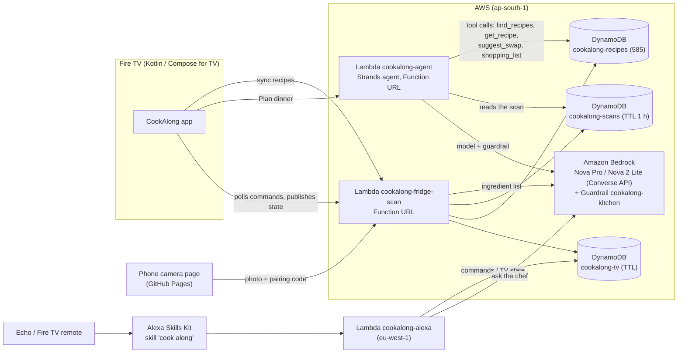

# AWS integration

CookAlong's AI and cloud features run on AWS, deployed in `ap-south-1` (Mumbai). The one exception is the Alexa skill
Lambda, which sits in `eu-west-1` because Alexa serves India from its Europe endpoint.

## Architecture



## Services and how each one is used

| Service | What it does in CookAlong |
|---|---|
| **Amazon Bedrock: Amazon Nova Pro and Nova 2 Lite** (Converse API) | Reads the fridge photo and lists the ingredients (`backend/lambda_function.py`); answers "ask the chef" questions through Alexa (`backend/alexa_skill.py`); is the reasoning model of the dinner-planner agent. Nova Pro first, Nova 2 Lite as backup. |
| **Strands Agents SDK** | The dinner-planner agent (`backend/dinner_agent.py`): the model decides which tools to call and in what order, then answers with a typed `DinnerPlan` (Pydantic structured output). |
| **Amazon Bedrock Guardrails** | `cookalong-kitchen` is attached to every agent model call: it denies medical and allergy-safety advice, filters abuse, blocks prompt attacks and masks emails and phone numbers. `backend/setup_guardrail.py` creates it. |
| **AWS Lambda and Function URLs** | Three functions: `cookalong-fridge-scan` (scan, recipes, TV bridge), `cookalong-agent` (Strands agent, 29 MB zip) and `cookalong-alexa` (skill, eu-west-1). No servers and no API keys in the app. |
| **Amazon DynamoDB** | `cookalong-recipes` (the catalog of 585 open-licence recipes), `cookalong-scans` (fridge-scan results, expire in 1 hour), `cookalong-tv` (Alexa pairing codes, per-TV command queues, per-TV rate limits). On-demand billing, with TTL on the short-lived tables. |
| **Amazon Polly** | The read-aloud voice on the TV: `POST /tts` on `cookalong-fridge-scan` returns MP3 from the generative voice Matthew (neural as backup). The TV caches each sentence and falls back to its own text-to-speech offline. Capped per request, per TV per hour and per day. |
| **AWS IAM** | One least-privilege role per function. Only Nova models and our guardrail can be invoked, and only the scan function may call `polly:SynthesizeSpeech`. |
| **Amazon CloudWatch Logs** | Function logs. Failures are logged without personal data. |
| **AWS CloudFormation** | `backend/template.yaml` recreates the tables, roles, both Function-URL Lambdas and the guardrail (validated with `aws cloudformation validate-template`, not deployed as a stack). The shell scripts `deploy.sh`, `deploy_agent.sh` and `deploy_alexa.sh` produced the live setup. |

Not used: Amazon Bedrock AgentCore. The CLI user in this account has no `bedrock-agentcore` permissions, so the agent
runs on Lambda instead.

## Why the agent is more than one model call

`POST /plan` takes the ingredients (or a fridge-scan code), servings, diet and time limit. The agent then:

1. calls `find_recipes` (rarity-weighted matching: paneer counts for more than onion, and sides and sweets rank lower);
2. calls `get_recipe` on the best candidates, scaled to the servings;
3. calls `suggest_swap` for important missing ingredients;
4. calls `shopping_list` for what to buy;
5. returns a structured plan.

The server then **re-checks every fact the TV shows**: the recipe exists, the diet and time limits hold, and the minutes,
missing items and shopping list come from DynamoDB. The model chooses and explains; it can't invent a recipe. The
response includes the tool-call trace (`steps`) so you can see what the agent did.

Safety and cost controls: the guardrail above, 12 plans per TV per hour and 300 plans a day across all TVs (counters in DynamoDB; the scan has a 500-a-day cap), inputs capped at 30
ingredients of 40 characters each, and no stack traces returned to the TV.

## Deploy it yourself

```bash
bash backend/deploy.sh           # tables, scan/recipes/TV-bridge Lambda
bash backend/deploy_agent.sh     # guardrail + dinner-planner agent Lambda
bash backend/deploy_alexa.sh     # skill Lambda (eu-west-1)
python tools/recipe_db.py upload recipes-data/batch-001.json   # recipes (see README)
```

Or use `backend/template.yaml` for everything except the skill Lambda:

```bash
aws cloudformation deploy --template-file backend/template.yaml --stack-name cookalong \
  --capabilities CAPABILITY_NAMED_IAM --parameter-overrides CodeBucket=<bucket> Prefix=cookalongdemo
```

Tests: `python -m unittest discover backend`.

## Product feedback

Feedback on every tool, including the AWS services above, is in [PRODUCT_FEEDBACK.md](PRODUCT_FEEDBACK.md); problems we hit are in [FRICTION_LOG.md](FRICTION_LOG.md).
